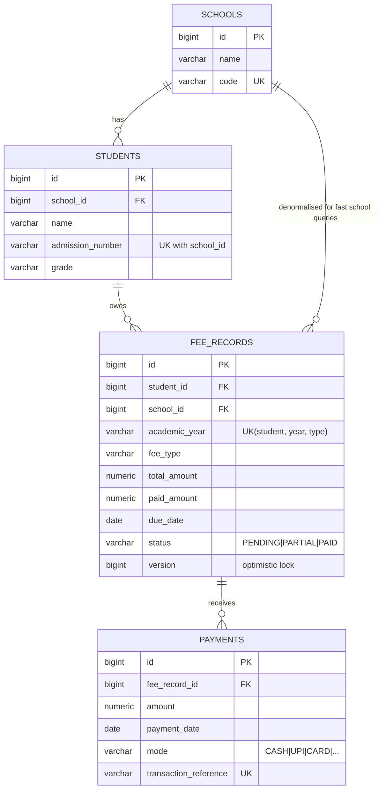

# Database

[← Back to README](../README.md)

PostgreSQL. Schema is generated from the JPA entities.

## ER diagram

All tables also have `created_at`, `updated_at` (`timestamp with time zone`, stored in UTC).

## Tables

| Table | Purpose | Key rules |
|---|---|---|
| `schools` | School (tenant) | `code` unique |
| `students` | Student of a school | `admission_number` unique **per school** |
| `fee_records` | One fee a student owes | unique `(student_id, academic_year, fee_type)`; keeps running `paid_amount` + `status` |
| `payments` | Payment against a fee | `transaction_reference` unique (blocks double entry) |

## Indexes

| Index | Speeds up |
|---|---|
| `fee_records (school_id, status)` | pending list & school summary |
| `fee_records (student_id)` | student fee details |
| `payments (fee_record_id)` | payment history |
| `students (school_id)` | students by school |

## Types
Money = `numeric(12,2)` (Java `BigDecimal`), ids = `bigint` identity, dates = `date`.
