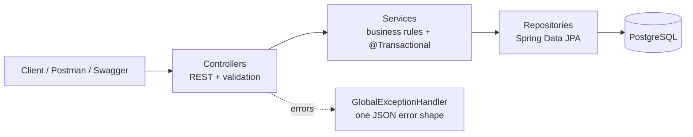
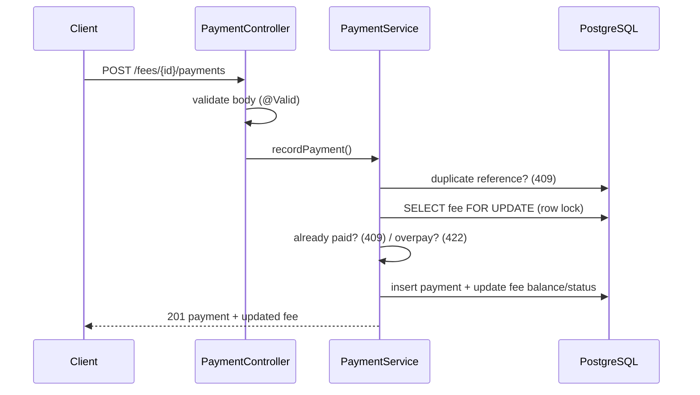

# Overview

[← Back to README](../README.md)

## Architecture



| Layer | Responsibility |
|---|---|
| Controller | HTTP mapping, input validation, status codes. No business logic |
| Service | Business rules, transactions, entity → DTO mapping |
| Repository | DB access, aggregate queries (pending list, summary) |
| Exception handler | Turns every error into the same JSON shape |

## Request flow – recording a payment



## Project structure

```
src/main/java/com/helloparent/fees
├── controller   REST endpoints only (no logic)
├── service      business rules, transactions
├── repository   JPA repos + aggregate JPQL (projection/)
├── entity       School, Student, FeeRecord, Payment
├── dto          request/ response/ records
├── exception    typed exceptions + GlobalExceptionHandler
└── config       Clock, Swagger info, demo DataSeeder
src/main/resources/application.yml   PostgreSQL config
src/test/resources/application.yml   test overrides (DB from Testcontainers)
docs/                                this documentation
postman/                             Postman collection
Dockerfile                           app image (multi-stage)
docker-compose.yml                   app + PostgreSQL 16
```
